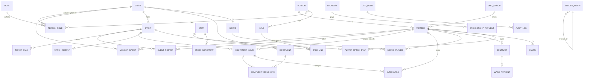

# Architecture

```
PySide6 screens (app/ui)      thin: collect input, call a service, show the result or the error
        |
Services (app/services)       one function = one business action = one transaction
        |        \
Rules (app/rules.py)    Models (app/models.py)  ->  MySQL
```
`ClubError` subclasses are expected rule violations (shown as warnings). Anything else is logged to
`mavumbi.log` and shown as an "unexpected error: nothing was saved" box.

## Entity relationships

Every money-moving service writes exactly one `ledger_entry` per cash event, in the same transaction.
Full column list: `DATA_DICTIONARY.md`. MySQL DDL: `schema.sql` (regenerate with `python manage.py schema-sql`).

## Ledger categories
IN: membership, store_sale, merchandise, facilitation, surcharge, ticket, sponsorship. OUT: patron_commission, wages.
A reversal posts the opposite direction in the same category, so category totals net off automatically.
